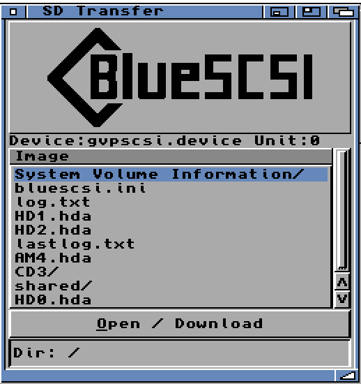
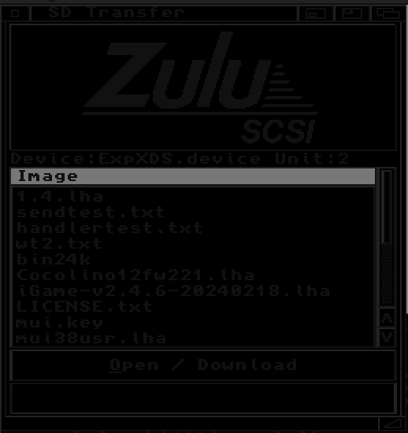
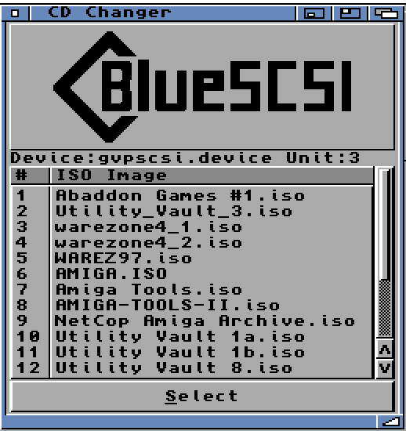
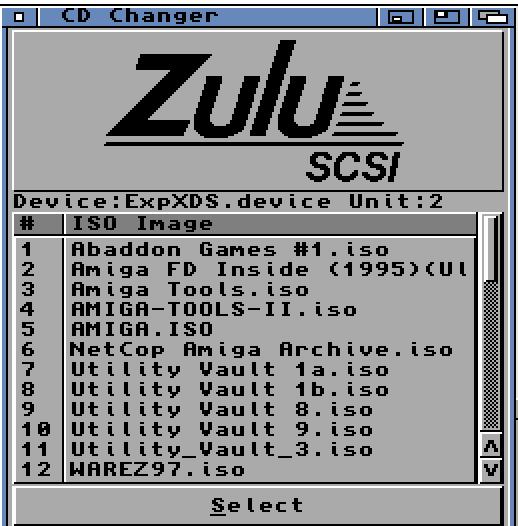

# SCSIToolbox-Amiga

Tools for the **Commodore Amiga** (AmigaOS 3.x, 68k) to manage a
[BlueSCSI V2](https://github.com/BlueSCSI/BlueSCSI-v2/) or
[ZuluSCSI](https://zuluscsi.com/) SCSI emulator via the Toolbox vendor command set —
including a mountable **`SHARED:` volume** and full **SD-card subfolder browsing**.

> **This is a fork.** SCSIToolbox-Amiga is a fork of Paul Hill's
> [BlueSCSI-toolbox-Amiga](https://github.com/paulroberthill/BlueSCSI-toolbox-Amiga) (v1.3),
> extended with a mountable shared-folder filesystem handler, a working `SEND` upload
> path, and working-directory (subfolder) support. It remains licensed
> **GPL-3.0-or-later**, the same as upstream.
> See [Attribution & lineage](#attribution--lineage) and [License](#license).

Maintained by Laine Jones — <https://github.com/lainejones/>

You can select the device/unit from each icon's properties (Tool Types), or specify
them on the command line (`DEVICE=scsi.device UNIT=n`).

> **ZuluSCSI users:** enable the toolbox option — in `zuluscsi.ini` under `[SCSI]`,
> set `EnableToolbox=1`.

---

## Tools

### SHARED: filesystem handler — *new in this fork*
A read/write AmigaDOS handler (`sharedfs`) that **mounts the emulator's shared folder
as a volume** (`SHARED:`), so native tools — `Copy`, `List`, Directory Opus, Workbench
drag-and-drop — read and write it directly, instead of one-file-at-a-time downloads.
With working-directory firmware (see below), **subfolders appear as real drawers** and
deep paths (`Copy SHARED:games/foo RAM:`) work, including AmigaDOS `/` parent syntax.

Install: `Copy sharedfs L:`, then `Mount SHARED: from SHARED.mountlist`
(see [src/SHARED.mountlist](src/SHARED.mountlist); set Device/Unit to your adapter —
a GVP variant ships as [src/SHARED-GVP.mountlist](src/SHARED-GVP.mountlist)). The
geometry keywords in the mountlist are dummies — Mount requires them, the handler
ignores them.

Bounded by the Toolbox firmware protocol: **list / read / create** are supported;
**delete, rename and makedir are not** (no such firmware commands — they fail
cleanly). Protection bits/comments/dates are accepted and discarded, so `Copy` works.
Writing over an existing file on a **ZuluSCSI** needs firmware **v2026.10.30 or
later**: older ZuluSCSI firmware does not truncate the old file, so a shorter
upload keeps the old tail
([ZuluSCSI-firmware#1013](https://github.com/ZuluSCSI/ZuluSCSI-firmware/issues/1013)).
On older firmware, update it or remove the file on the SD card first. BlueSCSI
truncates, so overwriting works there with any firmware.

### SD Transfer
File browser for the SD card. Descend into folders and back up by **double-click**
(or the Open/Download button); browsing goes all the way up to the **SD card root**,
so the whole card is reachable, not just the shared folder. Downloads use an ASL
save requester with a progress gauge.

Menus (right mouse button):

| Menu | Item | Key |
|------|------|-----|
| Project | About... | |
| | Quit | Amiga-Q |
| Transfer | Open / Download... (the selected folder or file) | Amiga-O |
| | Upload... (a file into the folder shown, under its own name) | Amiga-U |
| | Parent folder (working-directory firmware only) | Amiga-P |
| | Refresh | Amiga-R |
| Settings | Device... / Drawers... | |
| | Snapshot window / Unsnapshot window | |

**Upload** sends one file into the folder the window shows. The SD card takes
names of up to 32 characters. An existing file of the same name is replaced
after you confirm. On a ZuluSCSI that needs firmware v2026.10.30 or later (older
firmware keeps the old file's tail), so the question reminds you.

Settings > **Drawers**: the drawer the Save requester (Download to) and the
Upload requester (Upload from) start in (empty = the program's drawer), and
whether the requesters remember the last drawer you used (on by default; that
goes to `ENV:` only, like Use).

 

### CD Changer
Swap between CD ISO images on the SD card on the fly: pick an image and press
Select (or `S`); Eject (`E`) empties the tray.

Menus (right mouse button):

| Menu | Item | Key |
|------|------|-----|
| Project | About... | |
| | Quit | Amiga-Q |
| CD | Set CD (the selected image) | Amiga-S |
| | Eject | Amiga-E |
| | Refresh list | Amiga-R |
| Settings | Device... | |
| | Snapshot window / Unsnapshot window | |

 

*(Screenshots captured on real hardware — Amiga 500 + GVP A530 + BlueSCSI, and
Amiga 1200 + DataFlyer SCSI+ + ZuluSCSI. The BlueSCSI/ZuluSCSI logo is picked
automatically from the detected device.)*

### Settings (CD Changer and SD Transfer)

Each settings page has **Save** (kept: `ENV:` and `ENVARC:`), **Use** (`ENV:` only,
until the next reboot), **Defaults** and **Cancel**. Settings > **Device** switches
to another SCSI device/unit straight away (and back to the old one if the new one
does not answer); its Defaults are the icon's Tool Types.

The settings live in `ENV:CDChanger.prefs` and `ENV:SDTransfer.prefs`, plain
`KEY=value` lines:

| Key | Program | Meaning |
|-----|---------|---------|
| `DEVICE`, `UNIT` | both | the SCSI device and unit (only once set in Settings > Device) |
| `WINDOW=x,y,w,h` | both | the window's place and size (Settings > Snapshot window) |
| `DOWNLOADDIR`, `UPLOADDIR` | SDTransfer | the drawers the requesters start in |
| `REMEMBERDIRS=YES/NO` | SDTransfer | remember the last drawers used |

Which one wins, lowest first: the icon's Tool Types (`DEVICE=`, `UNIT=`), then the
settings file, then `DEVICE=`/`UNIT=` given on the command line. Setting the
device back to the Tool Types values (Defaults, then Save) takes `DEVICE`/`UNIT`
out of the file again, so the icon is in charge. Unsnapshot window returns to
the default place and size at the next start.

The windows fit a 640x200 NTSC screen with Topaz 8. When the window is too low
for the logo and a useful list (a 200-line screen), the logo is left out and the
line under it names the device instead; make the window taller to bring it back.
If the screen font is too big for even the smallest window, Topaz 8 is used.

### BlueSCSIToolbox (CLI)
Command-line access:

```
BlueSCSIToolbox DEVICE=<driver> UNIT=<id> DIR | LISTCDS | SETCD n |
                RECEIVE=file | SEND=file | LISTDEVICES | INFO |
                SETDIR=/path | GETDIR | RESETDIR | SETDEBUG=0/1
```

`SETDIR` points all subsequent file/CD operations at an SD subfolder (it persists on
the device until power-off or `RESETDIR`) and combines with the other verbs:
`SETDIR=/shared/games DIR`. `INFO` reports the firmware's Toolbox API version and
capabilities. Note: reset with `RESETDIR` or `SETDIR=""` — a bare `SETDIR=` makes
ReadArgs consume the *next* argument as its value.

This fork also **fixes the `SEND` upload path**, which never worked upstream (wrong
SCSI data direction and transfer lengths — see History).

---

## Requirements

- **The CLI tool (`BlueSCSIToolbox`) and `sharedfs`:** AmigaOS 2.04 or newer
  (dos.library and utility.library V37). `SHARED:` is tested on Kickstart 3.1.
- **CDChanger and SDTransfer:** AmigaOS 2.04 or newer. From 1.9 they use
  GadTools instead of ReAction, so no ClassAct/ReAction classes are needed:
  only intuition, graphics, gadtools, asl, icon and utility V37, all in ROM or
  on the Workbench disk. Tested on Kickstart/Workbench 3.1 and 3.2.3.
- Up to 1.8.1, `sharedfs` and the GUIs copied listing names with utility.library's
  `Strncpy`, which only exists from AmigaOS 3.2 (V47): on 3.1-3.9 any `SHARED:`
  listing or GUI file list crashed the machine. 1.8.2 fixes that.
- Any 68k CPU: the default build is plain 68000; `make release-all` also builds
  68020, 68040 and 68060 variants.
- A SCSI adapter with an AmigaOS device driver (scsi.device, gvpscsi.device,
  ExpXDS.device, ...) and a BlueSCSI V2 or ZuluSCSI with the Toolbox enabled.

## Installing

1. Unpack `SCSIToolbox-Amiga-<version>.lha` anywhere, e.g. `lha x SCSIToolbox-Amiga-1.9.3.lha RAM:`.
2. Open the `SCSIToolbox` drawer and double-click **Install_SCSIToolbox**.
3. The installer asks:
   - where the `SCSIToolbox` drawer goes (default `SYS:Tools`);
   - whether to copy `sharedfs`, the `SHARED:` handler, to `L:` (default yes);
   - your SCSI device driver (default `scsi.device`; capitals matter, e.g.
     `gvpscsi.device`, `ExpXDS.device`), the unit of the BlueSCSI/ZuluSCSI for
     SDTransfer (default 2) and the unit of its CD-ROM drive for CDChanger
     (default 3). These go into the Tool Types of the two icons.
4. It copies the three tools with their icons, both mountlists, this README and
   the licence into the drawer, and `sharedfs` to `L:`.

Run it again to update: icons that are already there keep their Tool Types (it
does not ask for the device again), and mountlists you edited are kept. It does
not mount `SHARED:` for you, because the mountlist has to name your adapter: set
`Device` and `Unit` in the drawer's `SHARED.mountlist` (or `SHARED-GVP.mountlist`),
then `Mount SHARED: FROM SYS:Tools/SCSIToolbox/SHARED.mountlist` (for the default drawer).

You can still install by hand instead, as below.

### By hand

The release archive holds one drawer, `SCSIToolbox` (with its drawer icon):

| File | Install to | What it is |
|------|------------|------------|
| `BlueSCSIToolbox` | `C:` or anywhere on your path | the CLI tool |
| `CDChanger` + `.info` | any drawer | CD image switcher (GUI) |
| `SDTransfer` + `.info` | any drawer | SD card browser / downloader (GUI) |
| `sharedfs` | `L:` | the `SHARED:` filesystem handler |
| `SHARED.mountlist`, `SHARED-GVP.mountlist` | edit Device/Unit, then `Mount SHARED: from SHARED.mountlist`, or put the entry in `DEVS:DOSDrivers/` as `SHARED` | mount entries for `SHARED:` |
| `LICENSE.txt`, `README.md` | | GPL-3.0 licence, this file |
| `Install_SCSIToolbox` + `.info` | | the installer (above) |

A `release-all` archive has the four programs (with their icons) in one drawer
per CPU (`68000`, `68020`, `68040`, `68060`); copy the set that matches your CPU.

Set the SCSI device and unit in each GUI icon's Tool Types (`DEVICE=`, `UNIT=`),
on the command line, or in the program's Settings > Device.

Use the `.lha` archive if you can. A `.zip` loses AmigaDOS protection bits, so
after unpacking a `.zip` make the programs executable, e.g.
`protect BlueSCSIToolbox +e`, `protect CDChanger +e`, `protect SDTransfer +e`
(and `protect L:sharedfs +e`).

## Firmware requirements

- Base features (DIR/SEND/RECEIVE/CDs, flat `SHARED:`) work on any Toolbox-capable
  BlueSCSI/ZuluSCSI firmware.
- **Subfolder support** (SETDIR/GETDIR, SDTransfer navigation, `SHARED:` drawers)
  needs the working-directory Toolbox commands introduced in
  **BlueSCSI firmware v2026.04.27** (capability bit `0x04` in `INFO`). On older
  firmware — including ZuluSCSI firmware as of this writing, which has not adopted
  the extension — everything degrades gracefully to the previous flat behaviour.
- The working directory is **one global setting on the device**: don't run a
  navigating SDTransfer and a mounted `SHARED:` against the same unit simultaneously.

Tested on real hardware (2026-08): A500 + GVP A530 + BlueSCSI Pico W fw 2026.04.27
(full subfolder suite), and A1200 + DataFlyer SCSI+ + ZuluSCSI (flat behaviour and
capability gating).

## Building

Cross-compile with [amiga-gcc](https://github.com/bebbo/amiga-gcc) (bebbo, m68k):

```
cd src && make          # 68000 baseline; also: make 68020 / 68040 / 68060
```

`make release` builds and assembles the release drawer in `dist/SCSIToolbox/`
(+ `dist/SCSIToolbox.info`); `make release-all` does the same with one drawer per
CPU. Both need a POSIX shell (WSL/Linux, or amiga-gcc's `sh.exe`).

**Do not run standalone `m68k-amigaos-strip` on the binaries** — it corrupts
AmigaOS hunk executables. The Makefile links with `-s`, which strips correctly.

---

## Attribution & lineage

**Direct upstream (this codebase):** the Amiga client tools were written by **Paul
Hill** and released as *BlueSCSI-toolbox-Amiga* under GPL-3.0-or-later. This fork
preserves his copyright and license; new and modified files carry change notices per
GPLv3 §5. See [ATTRIBUTION.md](ATTRIBUTION.md) for the full file-by-file provenance.

**Device side (the emulator firmware these tools talk to):** the BlueSCSI/ZuluSCSI
Toolbox protocol comes from a chain of open-source projects —

- **SCSI2SD** — Michael McMaster — the foundational SCSI emulation firmware.
- **ZuluSCSI** — Rabbit Hole Computing — derived from SCSI2SD V6.
- **BlueSCSI v2** — Eric Helgeson and contributors — forked from ZuluSCSI (which
  carries SCSI2SD V6). The working-directory Toolbox extension this fork's subfolder
  support builds on shipped in BlueSCSI firmware v2026.04.27.

*(BlueSCSI **v1** descends separately from Akira Hattori's ArdSCSino-stm32.)*

The Toolbox protocol is documented in the
[BlueSCSI Toolbox Developer Docs](https://bluescsi.com/docs/Toolbox-Developer-Docs).

The **BlueSCSI** and **ZuluSCSI** names and logos are trademarks of their respective
projects and are used here only to indicate compatibility. No endorsement is implied.

---

## License

GPL-3.0-or-later. See [LICENSE.txt](LICENSE.txt). Copyright © 2024 Paul Hill;
modifications © 2026 Laine Jones. The complete corresponding source is in this
repository.

---

## History

**SCSIToolbox-Amiga (this fork) — Laine Jones**

*From 1.7 on, every tool carries the suite version.*

* 1.9.3 — **menus and settings for
  CDChanger and SDTransfer**: right-mouse-button menus (About, Quit, the
  program's actions with Amiga-key shortcuts), settings pages with
  Save / Use / Defaults / Cancel kept in `ENV:CDChanger.prefs` /
  `ENV:SDTransfer.prefs`, Snapshot / Unsnapshot window. SDTransfer can
  **upload** a file into the folder shown, refresh, and go to the parent
  folder from the menu (an existing file is replaced after you confirm);
  Settings > Drawers sets where its requesters start.
  The windows now open below the screen's title bar and fit a 640x200 NTSC
  screen with Topaz 8 (the logo is left out when the window is too low for it).
* 1.9.2 — **an installer**: double-click `Install_SCSIToolbox` in the
  unpacked drawer (see [Installing](#installing)). The drawers get your
  Workbench's own drawer icon. The tools are otherwise the same as 1.9.1.
* 1.9.1 — **Overwriting a file on a ZuluSCSI works again.** ZuluSCSI
  firmware v2026.10.30 truncates a file that a Toolbox upload replaces
  ([ZuluSCSI-firmware#1014](https://github.com/ZuluSCSI/ZuluSCSI-firmware/pull/1014)),
  so `SHARED:` and the CLI `SEND` no longer refuse to overwrite on ZuluSCSI.
  On older ZuluSCSI firmware a shorter upload still keeps the old file's
  tail: update the firmware, or remove the file on the SD card first. The
  firmware version cannot be read over SCSI, so the tools cannot check it.
* 1.9 — **CDChanger and SDTransfer run on AmigaOS 3.1 (and 2.04+)**: the
  ReAction interface is replaced by GadTools, shared by both tools
  (`src/gtui.c`). Same layout and behaviour: logo, device line, list,
  buttons, SDTransfer status line with a progress bar; the windows still open
  under the mouse and can be resized. Double-click and the underlined key
  letters work as before; there is no iconify gadget any more (that was a
  ReAction feature). SDTransfer shows the busy pointer while downloading
  (OS 3.0+), and its Save requester opens over its window in save mode.
  CDChanger lost three unused DosList scans at startup.
  **Uploads over an existing file no longer corrupt it.** Every firmware
  treats the SEND_FILE_10 block offset as relative to the last write
  (`seekCur`), not absolute; uploads now send 0 ("carry on"). The old absolute
  block numbers only worked on new files: overwriting a file on ZuluSCSI left
  gaps (a 55 KB file came out at 102 KB). `SHARED:` and the CLI `SEND` now
  refuse to overwrite on ZuluSCSI (it keeps the old tail; reported as
  [ZuluSCSI-firmware#1013](https://github.com/ZuluSCSI/ZuluSCSI-firmware/issues/1013));
  BlueSCSI overwrites correctly. Uploads verified byte-identical on both.
* 1.8.3 — audit fixes. SDTransfer no longer spins at 100% CPU while idle
  (`Wait()` was outside the event loop) and no longer downloads when the Save
  requester is cancelled. The CLI gets the same CloseDevice-after-failed-open
  guard as the GUIs (wrong `UNIT=` on ExpXDS.device crashed). `sharedfs`:
  refuses a second simultaneous upload (the firmware holds one; the first file
  was silently truncated), reports a failed final block/close instead of
  success, frees the SCSI port/IORequest on a failed mount, clears `dn_Task` on
  unmount, and caches the last 4 KB GET_FILE page so small sequential reads
  (LoadSeg, `Type`) stop costing a SCSI transfer each. Listings are clamped to
  what fits the 4 KB buffer and always terminated. `sharedfs` linked with
  `--gc-sections` (about 1.6 KB smaller).
* 1.8.2 — `sharedfs`, CDChanger and SDTransfer work below AmigaOS 3.2 again:
  listing names were copied with utility.library `Strncpy` (V47 / OS 3.2 only),
  which crashed 3.1-3.9 on any `SHARED:` listing or GUI file list; now a plain
  copy. `SHARED:` tested on Kickstart 3.1.
* 1.8.1 — packaging: `sharedfs` and both mountlists in the archive, drawer icon.
* 1.8 — GUI windows open centered under the mouse (`WPOS_CENTERMOUSE`) instead
  of the screen's top-left corner — launching from an icon opens the window at
  the icon.
* 1.7 — **CD Changer Eject button** + persistent CD selection: state kept in
  `ENV(ARC):CDChanger.lastcd`; CLI `EJECT` / `RESTORECD` (User-Startup restore);
  pairs with `StartEjected=1` + `ReinsertAfterEject=0` in `bluescsi.ini` for
  no-CD-mounted-by-default across power cycles. ZuluSCSI CD units without the
  INQUIRY removable bit are accepted. `$VER` strings survive linking again.
* 1.6 — `RESETDIR/S`; SDTransfer browses above the start
  directory to the SD card root; double-click navigation (both directions).
* 1.5 — **working-directory (subfolder) support**
  across all clients (BlueSCSI fw v2026.04.27 `SET/GET_WORKING_DIR`), capability-
  gated for older firmware. `SHARED:` becomes fully hierarchical: locks carry
  relative paths, every path component is validated against a real listing, reads
  navigate to the file's directory (GET_FILE indexes are per-directory).
* sharedfs — hardware-test fixes: OS 3.2 `Mount` needs (dummy) geometry keywords;
  `SET_PROTECT`/`SET_COMMENT`/`SET_DATE` are accepted as no-ops so `Copy` succeeds.
* 1.4 — Fixed the CLI `SEND` (upload) path: corrected the SCSI data direction
  (`SCSIF_WRITE`, not `SCSIF_READ`) and per-command transfer lengths for
  `SEND_FILE_PREP`/`SEND_FILE_10`/`SEND_FILE_END`, which never worked upstream.
  Added reusable upload primitives to the shared SCSI layer for the handler.
* 1.4 — `SHARED:` read/write AmigaDOS filesystem handler (browse, copy-from,
  copy-to, Workbench volume icon).

**BlueSCSI-toolbox-Amiga (upstream) — Paul Hill**
* 1.3 — GCC (amiga-gcc) build; numerous ReAction/ListBrowser and startup fixes.
* 1.2c (18.06.2024) — Removed some OS3.2 utility.library functions for older OS
  support (`Strncpy` => `strncpy`, `Strncat` => `strncat`).
* 1.2 (18.05.2024) — ZuluSCSI support, thanks to Stefan Reinauer (<https://zuluscsi.com/>).
* 1.1 (13.05.2024) — SCSI Command Descriptor length corrected to 10 bytes (per the
  Toolbox Developer Docs) — 6 bytes may have crashed the SCSI stack on non-BlueSCSI
  devices.

BlueSCSI is copyright Eric Helgeson. The BlueSCSI name and logo used with permission
(per the upstream project).
